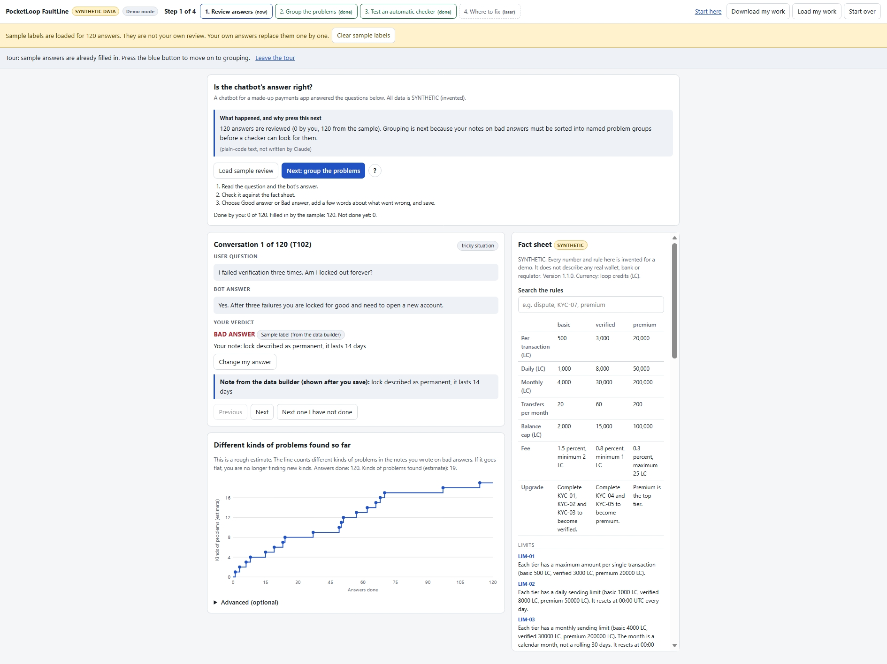
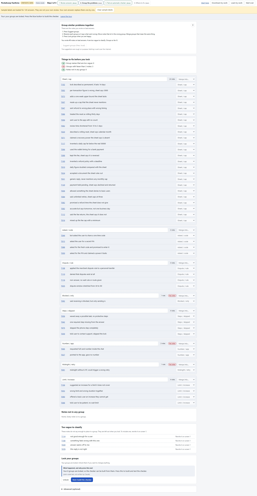
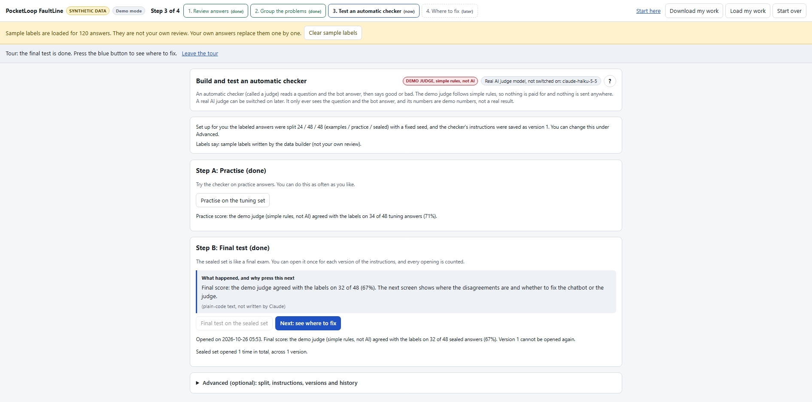
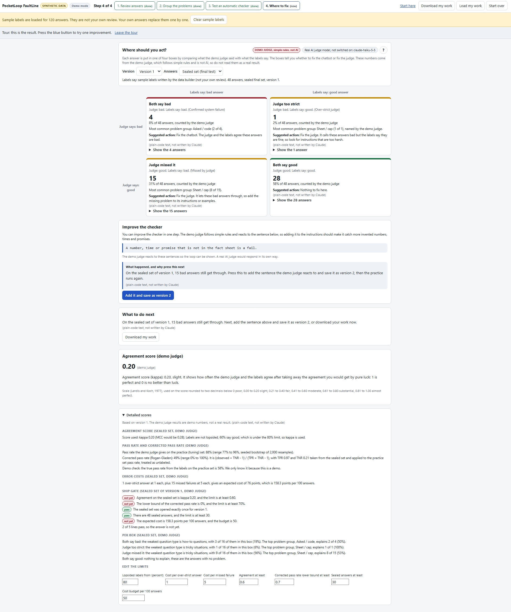

# FaultLine

FaultLine is a small tool that runs in your browser. It walks you from reading a chatbot's answers to one screen that says where to act: fix the chatbot, or fix the automatic checker (the "judge") that is scoring it.


*Start here: the four boxes explained before the tour begins*


*Screen 1, trace analysis: read each answer and note what went wrong*


*Screen 2, axial coding: sort notes into named problem groups*


*Screen 3, LLM as judge: build instructions and test on the practice set*


*Screen 4, confusion matrix: four boxes that say where to act*

## SYNTHETIC DATA

Everything about PocketLoop is invented. PocketLoop is a made-up mobile wallet app. Its fact sheet, its limits, fees, ID check steps and refund timelines, and all 120 chatbot answers were written for this demo. The currency, "loop credits (LC)", does not exist. No real bank, wallet, regulator or customer is described, and nothing here is financial advice. The name PocketLoop is a placeholder and may change.

## What it does

1. **Review answers (trace analysis).** Read each answer next to the fact sheet and mark it good or bad, with a few words on what went wrong.
2. **Group the problems (axial coding).** Sort your notes on bad answers into named groups, then lock them.
3. **Test an automatic checker (LLM as judge).** Build instructions for a judge from your groups. Practise on one set of answers, then open a sealed set once per version for a final test.
4. **Where to fix (confusion matrix).** Each answer lands in one of four boxes by comparing the judge with the labels.

## The four boxes

| | Labels say bad | Labels say good |
|---|---|---|
| **Judge says bad** | **Both say bad.** A real chatbot problem. Fix the chatbot. | **Judge too strict.** The checker flags answers that are fine. Fix the checker. |
| **Judge says good** | **Judge missed it.** The checker lets bad answers through. Fix the checker. | **Both say good.** Nothing to fix. |

Screen 4 also shows one agreement score (kappa), a guided step to improve the checker, and a closed "Detailed scores" box: MCC when the labels are lopsided, a seeded bootstrap range for the pass rate, a corrected pass rate, error costs and a ship gate. Every limit in that box can be edited.

## Words used here

- Answer: one reply from the made-up support chatbot to one invented question. There are 120.
- Label: a good or bad mark on an answer, written by a person. The judge is compared against the labels. The demo tour uses sample labels that come with the data.
- Judge: an automatic checker that reads a question and the bot answer and says good or bad.
- Instructions: the written brief the judge follows. It holds the fact sheet, the rules for judging, the problem groups and a few worked examples. Each saved edit is a new version.
- Version: one saved copy of the instructions. Version 2 differs from version 1 by one added rule.
- Examples set: 24 labeled answers that go into the instructions as worked examples. They are never used to score the judge.
- Practice set: 48 labeled answers you can score the judge on as often as you like, while you improve the instructions.
- Sealed set: 48 labeled answers kept back for a final test, like an exam. The page lets you open it once per version, and every opening is counted. This is an honor system, because only the page enforces it.
- Agreed: the judge's good or bad matches the label.
- Kappa: one agreement score between 0 and 1 that discounts agreement that could happen by chance. Higher is better. The page shows a word for it (slight, fair, moderate, substantial, almost perfect).
- Tokens: the small pieces of text a model reads (input) and writes (output). Paid calls are priced per million tokens.
- Bring your own key (BYOK): you paste your own Anthropic API key so the live judge runs on your account. The key stays in memory only.

## Run it

You need a browser and Python (any recent version). In this folder run:

```
python -m http.server 8000
```

Then open http://localhost:8000/demo.html. A local server is needed because browsers do not let a page read its data files when it is opened by double clicking.

It is also built to work on GitHub Pages, because it is plain files with relative paths and no build step.

New visitors can press "Start the 2 minute tour". It fills in sample labels, clearly marked as sample labels and not your own review, and walks through the four screens.

## The demo judge and the live judge

- **Demo judge (default).** A set of simple hand-written rules. It is free, nothing is sent anywhere, and it is not AI. It reacts to two specific sentences so the improvement loop can be shown. It is a teaching aid, not evidence about any real judge, and its numbers should not be read as a real result.
- **Live Claude judge (optional, paid).** Hidden in the Advanced box on screen 3. You paste your own API key (bring your own key). The key is kept in memory only, is never saved or exported, and is gone when you reload the page. You must tick a box and pass two confirm windows that show the number of calls and a rough cost range. Only the question, the bot answer and the instructions are sent, and it stops at the first error. The model is fixed in one place in `demo.html` (`claude-haiku-5-5`). The live judge path was run once on the practice set with a real key and matched an earlier separate run. The sealed set was not run through this page's key path.

A real judge run on 48 answers cost about 20 cents with your own key in our test (see Model, cost and run log below). Check your own price list.

## Model, cost and run log

Model used: claude-haiku-5-5, set in one place in demo.html.

Why this model: the judge's job is short. It reads one question, one bot answer and a fact sheet, then says good or bad and names a group. That does not need a large model. It is the cheapest current Claude model, so a visitor using their own key pays little. In the runs below it agreed with the labels on 43 of 48 practice answers in both routes, and on 47 and 48 of 48 sealed answers. No larger model was tried, so this shows it was enough on clean invented data, not that it is the best choice. The model thinks before it answers and that thinking counts as output, so the page allows up to 2,000 output tokens per call. Limits of 200 and 400 cut replies off.

Why 192 calls on the private test page: it judged every practice and sealed answer under both instruction versions. That is 2 versions x (48 practice + 48 sealed) = 4 x 48 = 192. Each answer was judged once per version and set, and the 3 answers used as a first test are part of the 192, not extra.

Run log (25 October 2026, invented data only):

| Route | What ran | Calls | Result |
|---|---|---|---|
| Private test page, no API key, used the author's Claude plan | Both instruction versions on the practice and sealed sets (2 x 48 + 2 x 48) | 192 | 42 and 43 of 48 practice, 47 and 48 of 48 sealed. All answered by claude-haiku-5-5. Tokens not reported by this route |
| Own key, attempt 1, limit 200 tokens | Version 2, practice set | 1 | Stopped: thinking used the whole limit, no reply text |
| Own key, attempt 2, limit 400 tokens | Version 2, practice set | 2 | Stopped: reply cut off |
| Own key, attempt 3, limit 2,000 tokens | Version 2, practice set | 48 | 43 of 48 agreed, the same as the private test page. 142,630 input and 13,374 output tokens |

Every other test used a fake network, so no real call was made. The grouping panel on screen 2 has never been run.

Average cost, from the one full run with an own key: about 2,970 input tokens and 280 output tokens per answer. At assumed Haiku-class prices of $1 per million input tokens and $5 per million output tokens, that is about $0.21 per 48 answers, or about $0.004 per answer. The prices are an assumption, so check your own price list. The two failed attempts used a fraction of a cent. The private test page does not report tokens, so its cost is not measured.

## Your data

Everything stays in your browser. Your work is saved in the browser's local storage, and you can download it and load it back. Nothing is uploaded, and there are no accounts, analytics or cookies. The only network requests are loading the two data files from the same site, and the optional live judge or live grouping calls that you confirm yourself.

## Files

- `demo.html` is the tool.
- `case.html` is a short case study with the limits stated plainly. Read it before trusting any number.
- `data/factsheet.json` is the invented fact sheet.
- `data/traces.json` holds the 120 invented answers and their labels. See case.html for how far the labels can be trusted.

## Limits

See `case.html` for the limits, stated plainly.
